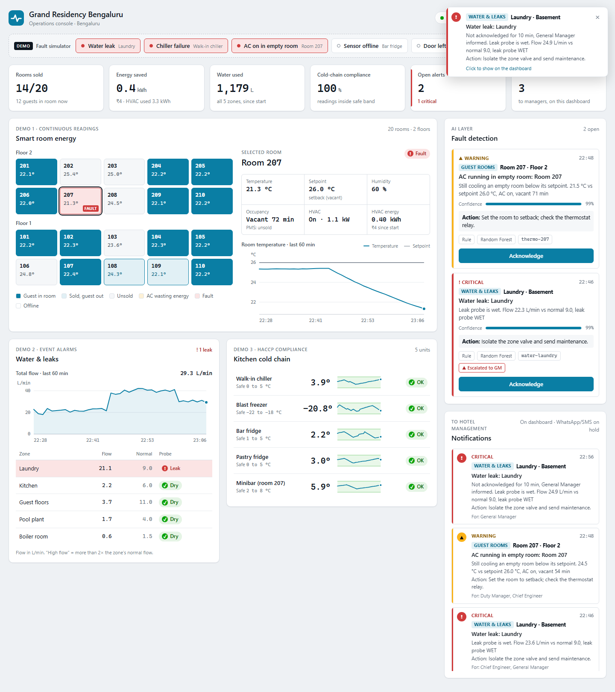
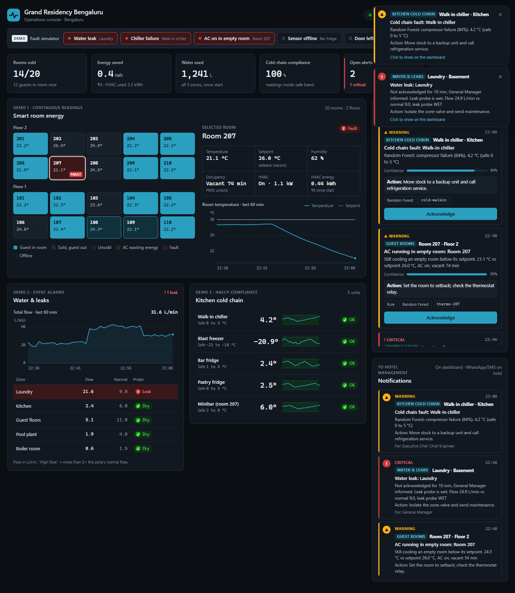
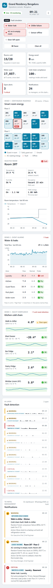

# hotel-iot-ai

**Smart-hotel IoT + AI monitoring** for a 20-room property in Bengaluru, with three IoT demos on one live
operations console:

| # | Demo | Sensors | Data style |
|---|---|---|---|
| 1 | **Smart room energy** | thermostat + occupancy (+ PMS "sold") in 20 rooms | continuous, every minute |
| 2 | **Water & leaks** | flow meter + leak probe in 5 zones | event-driven (leak = alarm) |
| 3 | **Kitchen cold chain** | temperature + door sensor in 5 fridges/freezers | compliance (stay in the safe band) |

An **AI layer** watches all 30 sensor streams (rules + Random Forest + Isolation Forest + trend forecast), raises
alerts, escalates unacknowledged critical ones to the General Manager, and **notifies management on the
dashboard**: which section, which room or unit, what to do, and who should act. (WhatsApp / SMS: on hold.)



## Quick start

Needs **Docker Desktop** ("Engine running").

```powershell
copy .env.example .env            # defaults work as-is
docker compose up -d --build      # first build ~3-5 min
```

Open **http://localhost:8080**, wait ~2 minutes for the charts to fill, then press a button in the
**Fault simulator** bar (e.g. *Water leak*): within seconds a notification pops up saying *Water & leaks ·
Laundry · Basement*. Stop with `docker compose down` (`-v` also wipes stored data).

**Presenting?** Follow [docs/DEMO_SCRIPT.md](docs/DEMO_SCRIPT.md): a 7-minute walkthrough with what to press,
what to say, and likely viva questions.

> Time is simulated 30x faster: **1 hotel minute = 2 real seconds** (10-minute escalation = 20 s).

## Architecture

```
 simulator (30 sensors, fault injector)
      │ MQTT  dt/hotel/blr01/{area}/{location}/{device}/telemetry
      ▼
 Mosquitto ──▶ backend (FastAPI) ───────────────────────────────▶ InfluxDB 3 (full history)
               │ ingestion: validate (Pydantic) ─▶ live store (now + last 60 min)
               │ AI engine, every hotel minute:
               │   rules · Random Forest · Isolation Forest · trend forecast
               │   └▶ alert manager: dedupe · upgrade · escalate · ack · resolve
               │        └▶ notifier: section + room/unit + who should act
               ▼ REST + WebSocket
 React dashboard (nginx :8080)
```

| Container | Port | |
|---|---|---|
| frontend (nginx + React) | **8080** | the dashboard |
| backend (FastAPI) | 8000 | API docs at http://localhost:8000/docs |
| mosquitto | 1883 | MQTT broker (anonymous, demo only) |
| influxdb (3 Core) | 8181 | time-series DB (`--without-auth`, demo only) |
| simulator | internal | fault API reachable only by the backend |

## Project layout

| Folder | What's inside |
|---|---|
| `simulator/` | sensor models for rooms, water and fridges, plus the fault injector (CLI + HTTP) |
| `ingestion/` | MQTT consumer, Pydantic schemas, InfluxDB writer (line protocol over HTTP) |
| `backend/app/` | FastAPI app, live store, REST + WebSocket, glue to the AI engine (`ai.py`) |
| `ai_engine/` | `rules.py`, `detector.py`, `alert_manager.py`, `model_loader.py` |
| `notifier/` | dashboard notifications (`dashboard.py`) and message text (`templates.py`) |
| `ml/` | synthetic data generator, features, training, forecast, evaluation ([ml/README.md](ml/README.md)) |
| `frontend/` | React + Vite dashboard, plain CSS tokens, hand-built SVG charts |
| `config/` | `devices.yaml`, `alert_rules.yaml`, `contacts.yaml` |
| `tests/` | pytest: simulator, ingestion, backend, rules, detector, notifier |
| `docs/` | [PROJECT_BRIEF.md](docs/PROJECT_BRIEF.md), [DEMO_SCRIPT.md](docs/DEMO_SCRIPT.md), screenshots |

## The AI layer

| Layer | Raises | How |
|---|---|---|
| **Rules** (`config/alert_rules.yaml`) | critical: leak probe wet, fridge out of band 3+ min · warning: flow > 2x normal 5 min, door open 5 min, AC cooling an empty room below setpoint, battery < 15 %, no data 3 min | fixed limits |
| **Random Forest** | names the fault: `leak`, `compressor_failure`, `door_left_open`, `hvac_stuck_on` | trained on labelled synthetic faults |
| **Isolation Forest** | "Unusual readings" nobody labelled (water + cold chain) | trained on normal data only; 5 unusual minutes in a row |
| **Trend forecast** | "Breach predicted in ~N min" → unit shows **At risk** | line through the last 8 readings |

The **alert manager** keeps one alert per device + fault (every layer that agrees is listed on it), upgrades a
warning to critical in place, **escalates** a critical alert not acknowledged in 10 min to the GM, and resolves
alerts 5 min after the fault is gone. Every important event becomes a **notification** with section, location
(`Room 207 · Floor 2`, `Laundry · Basement`, `Walk-in chiller · Kitchen`), action and the roles that should act
(`config/contacts.yaml`). Click a notification or alert to jump to that room or unit.

**Results on an unseen synthetic test week** (details: [ml/README.md](ml/README.md), [ml/evaluation_report.md](ml/evaluation_report.md)):

| Fault | Best method | Caught | False alarms/day | Detected after |
|---|---|---|---|---|
| AC on in empty room | Random Forest | 21/21 | 0 | 13 min |
| Water leak (incl. drips) | Random Forest | 13/14 | 0 | 1 min |
| Chiller compressor failure | Trend forecast | 5/7 | 0 | **6 min before the breach** |
| Door left open | Random Forest | 14/14 | 0 | 4 min |
| Sensor offline | Heartbeat rule | 14/14 | 0 | 3 min |

Real public data: Isolation Forest caught 3/4 failures in the NAB machine-temperature series; Random Forest scored
macro F1 0.83 on real LBNL fan-coil faults (1.00 on "cooling valve stuck open"); UCI room data calibrated the
simulator's room physics.

## Tests

```powershell
python -m venv .venv
.\.venv\Scripts\pip install -r backend\requirements.txt -r ml\requirements.txt pytest httpx
.\.venv\Scripts\python -m pytest                  # 32 tests, ~3 min (the detector tests run the simulator)
```

| File | Checks |
|---|---|
| `test_simulator.py` | normal day stays in range; each fault shows in the data; fault API rejects bad input |
| `test_ingestion.py` | every simulator message passes the schemas; 8 kinds of bad message are rejected; exact line protocol |
| `test_backend.py` | API views, statuses, KPIs, acknowledge, WebSocket snapshot, fault endpoints |
| `test_rules.py` | every rule fires exactly at its threshold, not before; alert text matches the brief |
| `test_detector.py` | simulator → AI → alerts: 3 quiet hours raise at most one stray warning; leak dedupe + escalation + resolve; ack stops escalation; forecast warns before the breach; AC + offline detected |
| `test_notifier.py` | notifications name the right section, room/unit and roles; no duplicates; escalation to GM |

The ML pipeline has its own reproducible evaluation (`cd ml; python evaluate.py`), and `python ml/forecast.py` self-checks.

## Configuration

| File | Purpose |
|---|---|
| `config/devices.yaml` | rooms, water zones (normal flow), cold units (safe bands), HVAC parameters, ₹/kWh |
| `config/alert_rules.yaml` | rule thresholds, severities, anomaly settings, escalation + auto-resolve times |
| `config/contacts.yaml` | manager roles and who gets which category; phone numbers only via `.env` |
| `.env` | settings and (later) API keys / phone numbers; never committed. Keep comments on their own line |

## Developer guide

<details>
<summary>Run parts locally, simulator CLI, InfluxDB queries, API endpoints</summary>

**Backend locally** (Mosquitto + InfluxDB from compose; stop the Docker backend first so port 8000 is free):
```powershell
docker compose up -d mosquitto influxdb
docker compose stop backend simulator
.\.venv\Scripts\python -m uvicorn backend.app.main:app --reload   # terminal 1 (from the repo root)
.\.venv\Scripts\python simulator\main.py                          # terminal 2
cd frontend; npm install; npm run dev                             # terminal 3 → http://localhost:5173
```

**Simulator** (`1 tick = 1 hotel minute`, default every 2 s):
```powershell
.\.venv\Scripts\python simulator\main.py --stdout --ticks 2        # print messages, no broker needed
.\.venv\Scripts\python simulator\main.py --fault leak:laundry --start 2026-10-24T22:00
```

| Fault (`--fault type[:target]`) | Default target | Effect |
|---|---|---|
| `leak` | `laundry` | flow +2x normal, leak probe wet after 2 min |
| `compressor_failure` | `walkin` | compressor stops, temperature climbs ~0.1 °C/min |
| `door_left_open` | `pastry` | door stays open, temperature climbs |
| `hvac_stuck_on` | `207` | room empty but AC keeps cooling |
| `sensor_offline` | `cold-bar` | device stops publishing |

**Standalone ingestion** (only when the backend is *not* running, otherwise data is written twice):
`.\.venv\Scripts\python -m ingestion.mqtt_consumer`

**InfluxDB** (tables `room`, `water`, `cold_chain`; tags `device_id`, `location`, `area`; time = hotel time):
```powershell
curl.exe "http://localhost:8181/api/v3/query_sql?db=hotel&format=pretty&q=SELECT+time,location,temp_c,hvac_on+FROM+room+ORDER+BY+time+DESC+LIMIT+5"
```

**API** (interactive docs: http://localhost:8000/docs)

| Endpoint | What |
|---|---|
| `GET /api/snapshot` | everything the dashboard needs in one call |
| `GET /api/rooms` · `/api/rooms/{room}` · `/api/rooms/{room}/history` | Demo 1 |
| `GET /api/water` · `/api/water/history` | Demo 2 |
| `GET /api/cold-chain` · `/api/cold-chain/{unit}/history` | Demo 3 |
| `GET /api/alerts?status=open` · `POST /api/alerts/{id}/ack` | AI alerts |
| `GET /api/notifications` | notifications to management |
| `GET /api/sim/status` · `POST /api/sim/faults` · `/api/sim/clear` · `/api/sim/pause` | fault buttons (off when `DEMO_MODE=false`) |
| `WS /ws` | `snapshot` on connect, then `reading`, `summary` (≤1/s), `alert`, `notification` |

**ML pipeline:** see [ml/README.md](ml/README.md). After retraining, rebuild the backend image
(`docker compose up -d --build backend`). It must use the same scikit-learn version (pinned in
`backend/requirements.txt`).

</details>

## Datasets

Raw data is not committed. Recreate with `python ml/download_datasets.py` (UCI + NAB, ~4 MB) and `--lbnl` (~530 MB).

| Dataset | Used for | Licence | Source |
|---|---|---|---|
| UCI Occupancy Detection | calibrating simulated room physics against real room sensors | CC BY 4.0 | [UCI #357](https://archive.ics.uci.edu/dataset/357/occupancy+detection) |
| NAB machine temperature + labelled windows | testing Isolation Forest on a real equipment failure | MIT | [numenta/NAB](https://github.com/numenta/NAB) |
| LBNL FDD, fan coil unit | testing Random Forest on real labelled HVAC faults | CC BY 4.0 | [data.gov](https://catalog.data.gov/dataset/lbnl-fault-detection-and-diagnostics-datasets) · [faultdetection.lbl.gov](https://faultdetection.lbl.gov/) |
| ASHRAE Great Energy Predictor III | not used (needs a Kaggle account) | Kaggle rules | [Kaggle](https://www.kaggle.com/competitions/ashrae-energy-prediction/data) |

LBNL citation: Granderson et al., "Building fault detection data to aid diagnostic algorithm creation and
performance testing", *Scientific Data* 7, 65 (2020). Water leaks and cold-chain faults use synthetic data,
because public leak datasets (LeakDB, BattLeDIM) model city pipe networks, not buildings.

## Limits and what production would need

- **Demo security:** InfluxDB runs `--without-auth`, MQTT is anonymous without TLS, and the dashboard has no
  login. All are marked `TODO (production)` in the code.
- **Memory-only live state:** alerts and notifications are lost when the backend restarts, and the charts refill
  in about 2 minutes. A HACCP audit trail would need them stored (SQLite / InfluxDB).
- **InfluxDB writes:** if InfluxDB is down, that batch is dropped rather than queued.
- **Synthetic faults:** they are cleaner than real ones. Real readings from ESP32 sensors are the next step.
- **WhatsApp / SMS on hold:** the message text (`notifier/templates.py`) and routing (`config/contacts.yaml`) are
  ready; sending would be one more listener on the alert manager. In India, business SMS needs **TRAI DLT
  registration** (sender ID + each template), and WhatsApp business-initiated messages need **Meta-approved
  templates**.

## More screenshots

| Dark theme | Phone |
|---|---|
|  |  |

Normal operation: [docs/screenshots/dashboard.png](docs/screenshots/dashboard.png).
